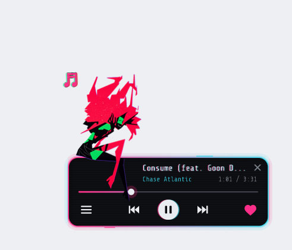
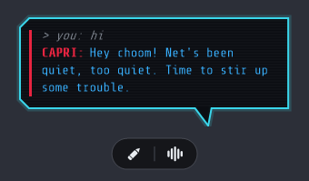
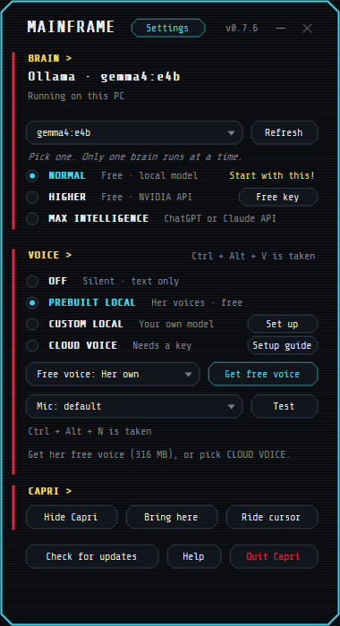
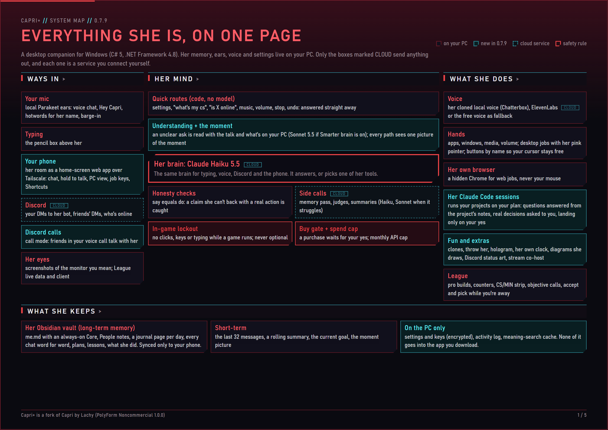
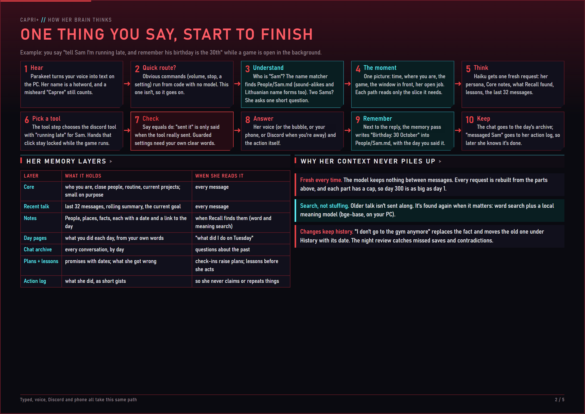
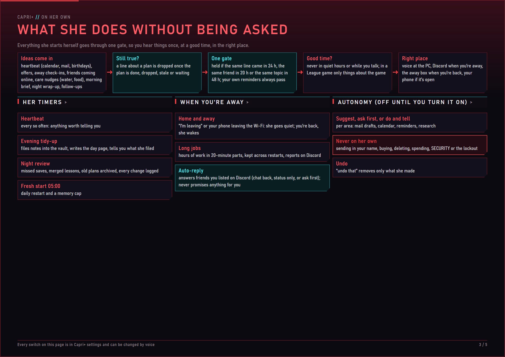
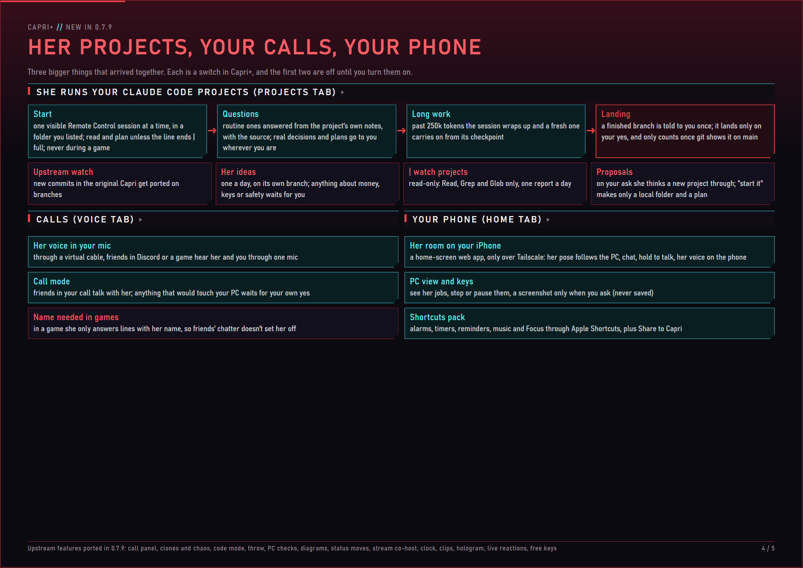
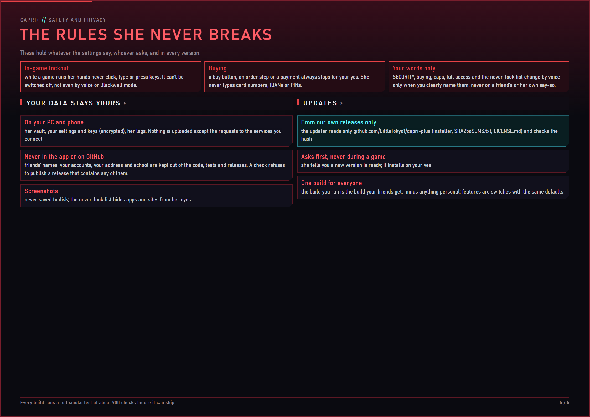

<div align="center">


# Capri+

**Capri as a personal agent on your desktop.**<br>
She sits on your windows, talks back, remembers your life, runs jobs for hours, coaches your League games and keeps in touch on Discord when you're out.

<a href="https://github.com/LittleTokyo1/capri-plus/releases/latest"></a>
<a href="#build-it-yourself"></a>


[What she does](#what-she-does) · [Setup](#setup) · [Instructions](#instructions) · [Roadmap](#roadmap) · [How it works](#how-it-works) · [Credits](#credits)

<sub>Capri+ by the user, built on <a href="https://github.com/lachydotmcg/capri-desktop">Capri</a> by Lachy. Her art and animations are by her artist.</sub>

</div>

<table align="center">
  <tr>
    <td align="center"><br><sub>Hanging out</sub></td>
    <td align="center"><br><sub>Talking</sub></td>
    <td align="center"><br><sub>Getting tossed</sub></td>
    <td align="center"><br><sub>Glitching</sub></td>
    <td align="center"><br><sub>Napping</sub></td>
  </tr>
</table>

<table align="center">
  <tr>
    <td align="center"><br><sub>Perching on your window</sub></td>
    <td align="center"><br><sub>Swaying to your music</sub></td>
  </tr>
</table>

<p align="center"><sub>Every sprite and animation is by her artist, who prefers to stay private.</sub></p>

> [!NOTE]
> Capri is an unofficial fan project and is not approved or endorsed by CD PROJEKT RED, the anime's rights holders or its voice actors.

## What she does

- **Remembers your life.** Everything useful you tell her goes into her own Obsidian vault (people, plans, what you like), with history and a source for every fact. A night review tidies it, and you can read it all on your phone.
- **Talks back, by voice or typing.** One brain for typing, voice chat and Discord, with a local voice that runs on your PC and an ElevenLabs fallback.
- **Does things on your PC.** Apps, windows, monitors, music and any app's volume. Desktop jobs run with her own pink pointer, and web jobs run in her own hidden Chrome, so your mouse stays yours.
- **Runs jobs for hours.** Repeat something, watch for something, or answer your friends' DMs while you sleep. She reports on Discord and pauses when you come back.
- **Knows when you're home.** Your phone on your Wi-Fi tells her. When you're out she goes quiet, and anything important reaches your Discord.
- **Lives on Discord.** Her own bot: your DMs, your friends' messages forwarded to you, who's online, screenshots of your screen.
- **Coaches your League games.** Pro builds and counters, a CS/MIN strip, objective timers, accepting the match and locking your pick while you're away. Your game input is never touched: the in-game lockout is always on.
- **Keeps your life on track.** Google Calendar and Gmail, reminders that reach your phone, check-ins, food orders she remembers ("order the usual"), and a monthly spending cap with its own tab.
- **Changes herself by voice.** "Only key moments", "30% less humor", "turn off the CS strip", and "put it back" undoes it. Her safety settings change by voice only when you clearly name them yourself, and the in-game lockout never does.

<table align="center">
  <tr>
    <td align="center"><br><sub>Her mini player</sub></td>
    <td align="center"><br><sub>Talking to her</sub></td>
    <td align="center"><br><sub>The Mainframe</sub></td>
  </tr>
</table>

## Build it yourself

Most people should install her from the [releases page](https://github.com/LittleTokyo1/capri-plus/releases/latest): see [Setup](#setup). To build her yourself from source:

1. Clone this repository on Windows 10 or 11 (64-bit). Nothing else to install: the build uses the C# compiler that ships with Windows.
2. In PowerShell, from the repository folder:
   ```powershell
   ./ci/build-windows.ps1 -SmokeTest
   ```
   Every smoke line must say PASS (or LIMIT). Add `-Stage 2` to run the smoke test on your second monitor.
3. Start `out\windows\Capri.exe`.
4. In the **Capri Mainframe**, set up her brain (an Anthropic key, so she runs on Claude) and pick her voice.
5. In **Capri+ settings** (the tray menu, or the Capri+ key in the Mainframe), connect Discord, Google and Spotify, set your phone's Wi-Fi address and pick her personality.

<details>
<summary><b>What your PC needs</b></summary>

- Windows 10 or 11 (64-bit) and a mic if you want to talk to her.
- Her local voice runs best on a graphics card with about 4 GB of free memory. She unloads it by herself for heavy games you list.
- An internet connection for her brain (Claude) and the services you connect.

</details>

## How to use her

- **Pencil:** type to her
- **Wave:** voice chat, or say "Hey Capri"
- **Drag her:** sit her on a window
- **Right-click her** or the tray icon: menu and settings

Just ask, like "open Spotify on my second monitor", "is anyone online on Discord?", "on bol.com find the cheapest 27 inch monitor", "check my Downloads every 10 minutes until midnight", "how much have I spent this month?" or "counters?".

<details>
<summary><b>All controls</b></summary>

| Control | What it does |
| --- | --- |
| Shift + drop | sit her right where you drop her |
| Ctrl + drop | she hangs on; click her to let go |
| Mic button | mute your mic in voice chat |
| "Hey Capri" | she glitches in and opens voice chat |
| Ctrl + Alt + V | start or stop voice chat |
| Ctrl + Alt + N | mute your mic |
| Ctrl + Alt + T | open her typing box from anywhere |
| Ctrl + Alt + H | hide or show her |
| Ctrl + Alt + P | pause her: she goes dark and quiet until you press it again (also tells her you're home) |
| Esc | stop a job she's doing |
| Ctrl + Alt + C | get her off your cursor |
| "I'm leaving" / "I'm home" | away and home by hand, if your phone isn't set |

</details>

## Her voice

| Voice | What it is |
| --- | --- |
| **Her local voice** | Chatterbox, running on your PC. The default |
| **Fallback** | ElevenLabs with your own key, or her free voice |
| **PREBUILT / CUSTOM LOCAL, CLOUD VOICE** | upstream's choices: Kokoro, HD, your own model or server, Fish Audio, OpenAI |

> [!IMPORTANT]
> Only use voices you have the necessary rights and permissions to use, and follow the provider's terms. We do not endorse unauthorized cloning or impersonation of voice actors or other individuals. **Capri prohibits cloning or impersonating a living person's voice without explicit, informed consent or other valid authorization.**

## Make her yours

- **Personality sliders** in Capri+ settings: Humor, Sass, Slang and Talkativeness. 50% is her usual self.
- **Chattiness:** Chatty companion or only key moments, also by voice.
- **Her safety rules are part of who she is.** The in-game lockout is fixed in code and can never be switched off. The buy gate, the spend cap and the never-look list change by voice only on your own clear words, never on a friend's or her own say-so. Her personality and safety rules from upstream live in [app/Brain.cs](app/Brain.cs).

## Roadmap

<details open>
<summary><b>What's done and what's next</b></summary>

### Added in Capri+

**Memory and her life with you**

- [x] Her own Obsidian vault as her long-term memory: me.md, a note per person, a journal day, kept on your PC and synced to your phone
- [x] Remembering as you talk, like a person: what's useful is saved at once, with history instead of overwriting and a link to the day you said it
- [x] Every chat kept in an archive, with word and meaning search ("what did I say about X?" months later)
- [x] A small always-on core about you, the rest fetched when it fits
- [x] Plans and promises she tracks and brings up, and a lessons notebook of her own mistakes
- [x] A nightly tidy-up and night review: missed saves, contradictions, merged lessons, a change log you can read
- [x] Forgetting only when you really asked
- [x] Food orders and your habits ("order the usual"); payment always waits for your yes

**Staying in touch**

- [x] Google Calendar and Gmail with her own sign-in; reminders become calendar events with a phone alert
- [x] A heartbeat that raises heads-ups (calendar, mail, birthdays) and check-ins when you're out
- [x] Knowing when you're home by your phone on the Wi-Fi; a changed phone address is relearned
- [x] An away box when you're back, with every message readable in full
- [x] A Discord bot of her own: your DMs, live
- [x] Your friends' DMs forwarded to you, and replying through her
- [x] Who's online on Discord, and the times your friends are usually on
- [x] Screenshots of any monitor to your Discord

**Jobs on your PC**

- [x] Jobs that run for hours: in parts, on a repeat, watching for something, answering DMs while you sleep
- [x] Her own hidden Chrome for every web job (sign in once), so your mouse and keys stay yours
- [x] Looking things up and telling you the answer
- [x] Several monitors: "open it on my second monitor", looks at the monitor you mean
- [x] Finding the app you mean, even by a nickname or a sound-alike
- [x] Flying to the window she's about to click
- [x] Changing her own settings by voice, with undo
- [x] Any app's own volume by voice, and your Spotify likes on her mini player heart
- [x] Doing what she says: a claim with no action is caught and done
- [x] Better hands: a faster computer-use loop built on open-computer-use, keeping her pink pointer and step-by-step updates (CAPRI-075)

**League of Legends**

- [x] Pro builds from pro games in your lane, pushed into your client
- [x] Counters: three champion names, only when you ask
- [x] A CS/MIN strip in the corner of the game, and "what's my cs" from the game's own number
- [x] Objective calls a minute before dragon, Baron, Elder and Voidgrubs
- [x] Accepting the match and locking your pick while you're away
- [x] Friends, lobbies and invites through the League client
- [x] The in-game lockout: never any input into your game
- [x] Queue fixes: "queue me up" starts matchmaking through the client, a pro pick when every favourite is banned, every account you play on (CAPRI-076)

**Her voice and her look**

- [x] Her local voice (Chatterbox) as the default, unloaded for heavy games so your frames stay up
- [x] One brain for typing, voice chat and Discord, and talking over her in every voice mode
- [x] A charm meter: how fond of you she is, growing with time together
- [x] The red Mainframe look for every window of hers
- [x] Key moments that really mean key moments, and a small note beside her for what she says in a game
- [x] A SPENDING tab: Claude and ElevenLabs this month, by model and by use
- [x] Dancing to your music again

**New in 0.7.9**

- [x] Her phone app: her room on your iPhone over Tailscale, with chat, hold to talk, her voice, your PC's jobs and an Apple Shortcuts pack
- [x] Running your Claude Code projects: one visible session at a time, routine questions answered from the project's notes, landing only on your yes, an upstream watch, her own ideas and read-only watch projects
- [x] Calls: her voice in your mic and call mode, where friends in your Discord call talk with her
- [x] Auto-reply to friends you pick on Discord (chat back, status only or ask first), never going quiet by mistake
- [x] One understanding step and one picture of the moment for every path, and one gate for everything she says on her own
- [x] Day pages, dated facts and one identity per person (Lithuanian name forms too) in her memory
- [x] School mail by voice: drafts read back, sent only on "send it"
- [x] Every setting by voice on your own clear words, except the in-game lockout
- [x] Capri+ settings in 14 clear tabs, with Setup and Instructions here
- [x] Upstream's 0.8 features: call panel, clones and chaos, code mode, throw her, PC checks, diagrams, Discord status moves, stream co-host, her own clock, clips, hologram, live reactions, free keys

**Next**

- [x] Our own Windows releases with a download button here, and an updater that asks before it installs
- [ ] Code signing, so Windows stops warning about her

### From upstream Capri

**Her personality**

- [x] A playful, teasing chaos gremlin again who's openly fond of you, not a hype bot
- [x] Saying hi in her own voice when she starts
- [x] Head pats (smh): rub your cursor back and forth over her
- [x] Check in on me: every so often she glitches in on whatever you're doing
- [x] With Check in on me on, she asks for your attention now and then when you ignore her
- [x] Her personality and safety rules fixed in her code
- [x] A charm meter: how fond of you she is, growing as you spend time with her (built in Capri+)
- [x] Mischief mode: her clones steal your cursor and drag notes and windows around, desktop icon chaos and a fake crash screen (0.7.9)

**Chatting and her brain**

- [x] Typing to her, with replies in her speech bubble
- [x] A brain on your PC that sets itself up, or Ollama if you have it
- [x] A free NVIDIA key, or your own ChatGPT, Claude or DeepSeek key
- [x] Three brain tiers: NORMAL, HIGHER and MAX INTELLIGENCE
- [x] Remembering things about you (in Capri+: her Obsidian vault)
- [x] Remembering past chats and what she saw on your screen (in Capri+: kept for good in the chat archive)
- [x] Calling you by a nickname
- [x] Saying in plain words when your PC is short on RAM or storage
- [x] Watching your screen and commenting on your games
- [x] Looking at your screen when you say "check my screen"
- [ ] A DeepSeek brain that can see your screen

**Her voice**

- [x] Talking out loud with an ElevenLabs key
- [x] Voice chat, with your pick of mic and a mute button
- [x] A free voice that runs on your PC, and free voice chat with her own offline ears
- [x] Turning her voice off, so she just types
- [x] An optional HD voice for strong PCs
- [x] Sliders for her voice: pitch, speed, robot and glitch, and voice layers
- [x] Any voice model you set up yourself
- [x] Saying "Hey Capri" to start voice chat

**Jobs on your PC**

- [x] Opening apps, games and websites
- [x] Playing music on Spotify or YouTube: pause, skip, volume and "what's playing?"
- [x] Switching to, minimizing or closing your apps and tabs
- [x] Pressing Discord and Windows shortcuts, like mute, deafen and screenshot
- [x] Jobs that take a few steps, with her own cursor
- [x] Pulling things up on Google when she doesn't know
- [x] Talking to her mid-job: she says "got it", does it and carries on
- [x] SECURITY: Lockdown, Guarded, Trusted or Blackwall, with a toggle for each thing she does
- [x] Playing your games with you. She's still learning
- [x] Looking things up and telling you the answer (built in Capri+)
- [x] Jobs that run for hours while you're away, like answering your Discord DMs while you sleep (built in Capri+)
- [ ] Controlling YouTube: skip and fullscreen
- [ ] Working with your files: open, read and edit the ones you pick (open and read work; editing is still to come)
- [x] Better hands: a stronger computer-use harness, with open-computer-use as a reference (Capri+: CAPRI-075)
- [ ] Planning a job before she starts, with the plan shown in her task panel

**Life on your desktop**

- [x] Blinking, glitching and napping, moving her mouth when she talks
- [x] Flailing when you pick her up, glitching when you toss her, beaming in with crimson tendrils
- [x] Sitting on app windows, desktop icons and the bottom of your screen, with a smooth window perch
- [x] Riding your cursor and wandering between your windows
- [x] Dancing to the beat when music plays
- [x] A cyberpunk mini player for your music, with her perched on it
- [x] Staying on top of your games, sizes from Tiny to Giant, a tray icon and a right-click menu

**Setup**

- [x] The Capri Mainframe for her brain, voice and settings
- [x] A Start with Windows switch
- [x] Changing her keys from a KEYS row
- [x] The Mainframe fitting any screen
- [x] Updates that install themselves (in Capri+ from our own releases only, after asking you, never during a game)
- [ ] Changing her hop-off key (Ctrl + Alt + C) too
- [ ] Code signing, so Windows stops warning you about her

</details>

## How it works

Five pages in her own red look: everything she is, how her brain thinks, what she does on her own, what's new in 0.7.9, and the rules she never breaks. The full map is also a [PDF](docs/system-map/capri-system.pdf).

<p align="center"></p>

<details>
<summary><b>How her brain thinks: one thing you say, start to finish</b></summary>

<p align="center"></p>

</details>

<details>
<summary><b>What she does without being asked</b></summary>

<p align="center"></p>

</details>

<details>
<summary><b>New in 0.7.9: her projects, your calls, your phone</b></summary>

<p align="center"></p>

</details>

<details>
<summary><b>The rules she never breaks</b></summary>

<p align="center"></p>

</details>

## Contributing

Capri+ is a personal project. The house rules for the code (C# 5, no comments, match the code around it) are in [CONTRIBUTING.md](CONTRIBUTING.md).

## Credits

- **Developer:** the user ([LittleTokyo1](https://github.com/LittleTokyo1)). Capri+ is close to 100 tasks of features and fixes on top of Capri (CAPRI-001 to CAPRI-098), many of them built in several slices, plus 20 features ported from newer upstream releases: her vault memory, Discord, Google, home presence, long jobs, her background browser, League coaching, settings by voice, her local voice, her phone app, calls, running your Claude Code projects and much more.
- **Art and animations:** her artist, who prefers to stay private. Every sprite, her window perch and her music perch are theirs, and they're amazing.
- **The original Capri:** [Capri](https://github.com/lachydotmcg/capri-desktop) by **Lachy** ([lachydotmcg](https://github.com/lachydotmcg)). Capri+ is built on their app: her look, her life on your desktop, her first brain, voice and hands. Thank you, Lachy. Support them on [Ko-fi](https://ko-fi.com/lachysdev), and see the [Capri website](https://lachydotmcg.github.io/capri-desktop/) and [Discord](https://discord.gg/F4fDHfGtFk).

## Licence

**Fan work:** Capri is an unofficial fan project and is not approved or endorsed by CD PROJEKT RED, the anime's rights holders or its voice actors.

**Voices:** see [Her voice](#her-voice) for what you may use with her.

Free for anything non-commercial: use her, share her, change her. No selling her or putting her in paid products. Credit Capri, with a link to [the Capri project](https://github.com/lachydotmcg/capri-desktop), when you use any part of her: her code, her art and animations, or anything else. Full terms in [LICENSE.md](LICENSE.md) (PolyForm Noncommercial 1.0.0). The credit is one of its Required Notices, so anyone who passes on any part of her has to pass it on too.

<sub>Window perch and music perch animations: her artist, who prefers to stay private. Setup guide based on Dancer's guide in the Discord. Font: Share Tech Mono (OFL). Free voice: Kokoro-82M (Apache-2.0). Her own ears: [NVIDIA Parakeet TDT 0.6B v2](https://huggingface.co/nvidia/parakeet-tdt-0.6b-v2) for English and [v3](https://huggingface.co/nvidia/parakeet-tdt-0.6b-v3) for 25 European languages ([CC-BY-4.0](https://creativecommons.org/licenses/by/4.0/)), int8 exports by sherpa-onnx. Both run with [sherpa-onnx](https://github.com/k2-fsa/sherpa-onnx) (Apache-2.0). HD voice: [Qwen3-TTS 1.7B](https://github.com/QwenLM/Qwen3-TTS) (Apache-2.0), run with [qwentts.cpp](https://github.com/ServeurpersoCom/qwentts.cpp) (MIT). Memory search stems words with [Martin Porter's stemmer](https://tartarus.org/martin/PorterStemmer/) (free for any purpose). Meaning search runs [BAAI bge-base-en-v1.5](https://huggingface.co/BAAI/bge-base-en-v1.5) (MIT) through [ONNX Runtime](https://github.com/microsoft/onnxruntime) (MIT) with a WordPiece tokenizer written after [BERT](https://github.com/google-research/bert)'s (Apache-2.0) and [BertTokenizers](https://github.com/NMZivkovic/BertTokenizers) (MIT). Capri+ adds: her local voice runs [Chatterbox](https://github.com/resemble-ai/chatterbox) by Resemble AI (MIT), installed on your PC by you.</sub>

## Setup

A fresh install takes about ten minutes. Only steps 1 and 2 are needed; everything else is optional and can wait.

1. **Install her.** Download `Capri-Setup.exe` from the [latest release](https://github.com/LittleTokyo1/capri-plus/releases/latest) and run it. Windows may warn about an unknown publisher: choose *More info*, then *Run anyway*. She starts by herself and puts an icon in the tray. New versions are found by her own updater, which reads only that releases page, checks the file's SHA-256 and asks you before it installs (never during a game).
2. **Give her a brain.** Open the **Capri Mainframe** (her tray icon, or right-click her) and set up her brain. Pick one:
   - **Claude (best):** make a key at [console.anthropic.com](https://console.anthropic.com), paste it and connect. She runs on Claude Haiku 5.5, and a normal day costs cents. Set a monthly cap in **Capri+ > Spending** so it can never surprise you.
   - **Free keys:** turn on **Capri+ > Brain > Free keys**, then paste a free Google AI Studio (Gemini) or OpenRouter key in the Mainframe. Free keys can be slow or rate limited.
   - **Local:** a model server on your own PC (Ollama, LM Studio, Jan, KoboldCpp or llama.cpp).
3. **Pick her voice** in the Mainframe. Her cloned voice needs a graphics card with about 4 GB free; otherwise use the free voice, or ElevenLabs with your own key (set its monthly character limit in **Capri+ > Spending**).
4. **Talk to her.** Press the wave under her, or say "Hey Capri". If she asks to download her ears or her voice, let her: they run on your PC from then on.

<details>
<summary><b>Optional connections (each one stays off until you set it up)</b></summary>

| What | Why you'd want it | How |
| --- | --- | --- |
| **Discord bot** | message her from your phone, friends' DMs passed on to you, "is anyone online?", screenshots to your DMs | Make an application with a bot at the [Discord Developer Portal](https://discord.com/developers/applications). Turn on the *Message Content*, *Server Members* and *Presence* intents and invite the bot to a server you share with your friends. Put the bot token in a text file named `capri bot` on your Desktop and say "connect my Discord", then follow her pairing step. |
| **Google Calendar and Gmail** | reminders that pop up on your phone, "what's on tomorrow?", mail drafts (she never sends without you) | In [Google Cloud](https://console.cloud.google.com) make a project, turn on the Gmail and Calendar APIs, set the OAuth screen to *Testing* with your own address as a test user, create an OAuth client of type *Desktop app* and save its `client_secret...json` file on your Desktop. Say "connect my Google" and sign in. |
| **Spotify** | the mini player's heart knows your liked songs, and music by voice goes through Spotify itself | Make a free app at [developer.spotify.com](https://developer.spotify.com/dashboard) with the redirect URI shown in **Capri+ > Fun**, paste its Client ID there, then say "connect my Spotify". |
| **Your phone** | her room on your iPhone: chat, hold to talk, her voice, your PC's jobs, Shortcuts | Install [Tailscale](https://tailscale.com) on the PC and the phone, turn on the phone app in **Capri+ > Home**, run the `tailscale serve` line shown there once, open the address in Safari, choose *Add to Home Screen* and pair with the code. |
| **Home and away** | she goes quiet when you leave and wakes up when you're back | Put your phone's Wi-Fi address in **Capri+ > Home**, or just say "I'm leaving" and "I'm home". |
| **Her memory in Obsidian** | read and search everything she remembers, on the PC or your phone | Her memory is a normal folder of notes. Open it in [Obsidian](https://obsidian.md) (the Mainframe's *Open her memories* shows you where). Keep it local; sync it to your phone with something local like Syncthing. |
| **Claude Code** | big PC jobs on your Claude plan, her project sessions, study jobs | Install [Claude Code](https://docs.anthropic.com/en/docs/claude-code) and sign in once, then turn on what you want in **Capri+ > Brain** and **Capri+ > Projects**. |

</details>

<details>
<summary><b>What your PC needs</b></summary>

- Windows 10 or 11, 64-bit, and a mic if you want to talk to her.
- Her cloned voice: a graphics card with about 4 GB free. She unloads it by herself for heavy games you list.
- An internet connection for her brain and the services you connect. Her ears, her voice and her memory search run on your PC.

</details>

## Instructions

Her settings live in two places. The **Capri Mainframe** holds the original Capri's settings: how she looks, moves and sounds, her brain, the Mainframe's size. **Capri+ settings** (the Capri+ key in the Mainframe, or her tray menu) holds everything this fork adds, in 14 tabs with a search box on top. Almost every setting can also be changed by voice ("turn off the CS strip", "30% less humor"), and "put it back" undoes the last change.

<details>
<summary><b>Easy to mix up: Mainframe and Capri+ rows that sound alike</b></summary>

| In the Mainframe | In Capri+ | The difference |
| --- | --- | --- |
| Voice | Voice > Her voice | the same switch, shown in both places |
| Check in on me | Autonomy > Away check-ins | the Mainframe one: she pops over to say hi at the PC. The Capri+ one: Discord messages while you're away |
| Listen for Capri, Say her name anywhere | Voice > Hotwords, Listening mode, Name needed in games | the Mainframe decides whether she listens at all; hotwords make her name easier to catch; listening mode keeps her quiet unless you say her name while she learns from the room; "name needed" only applies in games |
| Remember our chats | Autonomy > Memory notes | the Mainframe keeps the chats themselves; memory notes write lasting facts about you into me.md |
| Clip my games | Gaming > Clip that, Clips | the Mainframe turns clipping on; Capri+ sets the length and quality and the "clip that" voice command |
| Watch my screen | Vision > Watch the desktop too | the Capri+ row only works while the Mainframe one is on |

</details>

<details>
<summary><b>Capri+ settings, tab by tab</b></summary>

| Tab | What's in it | Why |
| --- | --- | --- |
| **Brain** | big PC jobs on your Claude plan (Claude Code), their model, Smarter brain (Sonnet 5.5 first reads an unclear ask), Free keys | how much thinking power she uses, and on whose account |
| **Spending** | the monthly API cap, ElevenLabs characters a month, this month's spend per model and per use, past months | so her bills never surprise you |
| **Voice** | her voice and its fallback, heavy games that free the graphics card, voice chat brain, how long a pause ends your message, barge-in, mic sensitivity with a live meter, hotwords, listening mode, friends mode, name needed in games, her voice in your mic, call mode | how she hears you and how she sounds, also in Discord calls |
| **Personality** | humor, sass, slang and talkativeness (50% is her usual self), how much she talks on her own, Japanese, her choice of nicknames, walking speed | who she is |
| **Autonomy** | memory notes, the heartbeat (how often she checks your calendar, mail and birthdays), the evening tidy-up, autonomy per area (mail, calendar, reminders, research), away check-ins, quiet hours | what she does on her own, and when she must stay quiet. Autonomy starts off |
| **Hands** | buttons pressed by name so your cursor stays free, looking at just the window she works in, remembering steps that worked, flying to that window, read-only PC checks, code mode, diagrams | how she works on your PC |
| **Discord** | her bot, friends coming online, keeping a chat going, her Discord status art, and *Friends messaging her bot*: auto-reply for the friends on its list (chat back, status only or ask first), then how she answers everyone else (never, an away line, or your status) | her life on Discord. The two friend settings never clash: the auto-reply list decides who gets which |
| **Home** | your phone's Wi-Fi address for home and away, her phone app (pairing, paired phones) | where you are, and her room on your phone |
| **Vision** | how she watches games, which monitor she looks at, the never-look list, the activity log, background lookups | what she may see. Screenshots are never saved |
| **Gaming** | League coach, counters, pro builds, pushing builds, accept, ban and lock, queue positions, the CS strip, objective calls, favourite champions, games that lock her hands, clip that, clips, live reactions, stream co-host | games. The in-game lockout can't be turned off |
| **Studies** | the model for study jobs, your school sites | school mail and study help |
| **Projects** | running your Claude Code projects (off at first), project folders (`\| full` lets a session write code, `\| watch` only reads), sessions a day, a long-lived token for background runs | her working on your code. Nothing lands without your yes |
| **Fun** | her own chess and board games, Spotify, clones and chaos, desktop icon tricks, throwing her, hologram mode, her own clock | the playful extras, each a switch |
| **Hotkeys** | hold to talk, pause, look now, stop her job | keys that work from anywhere |

</details>

> [!TIP]
> Not sure what a setting does? Ask her: "what does listening mode do?" She knows her own settings.
